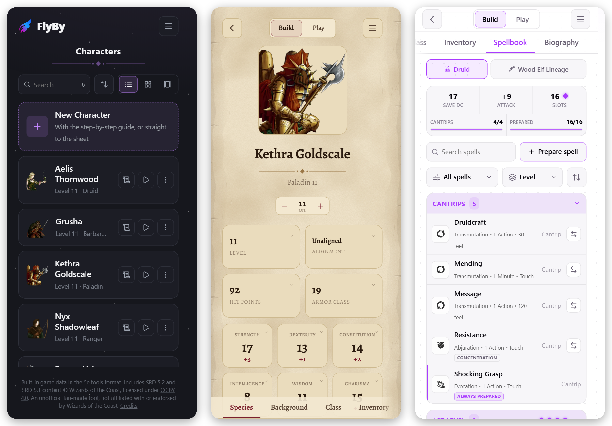
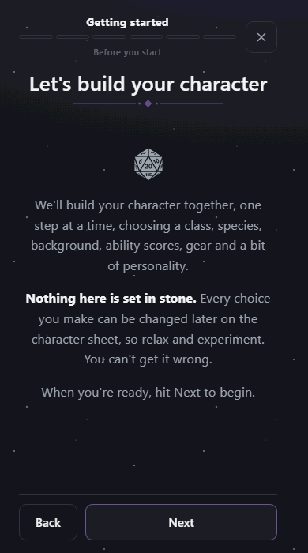
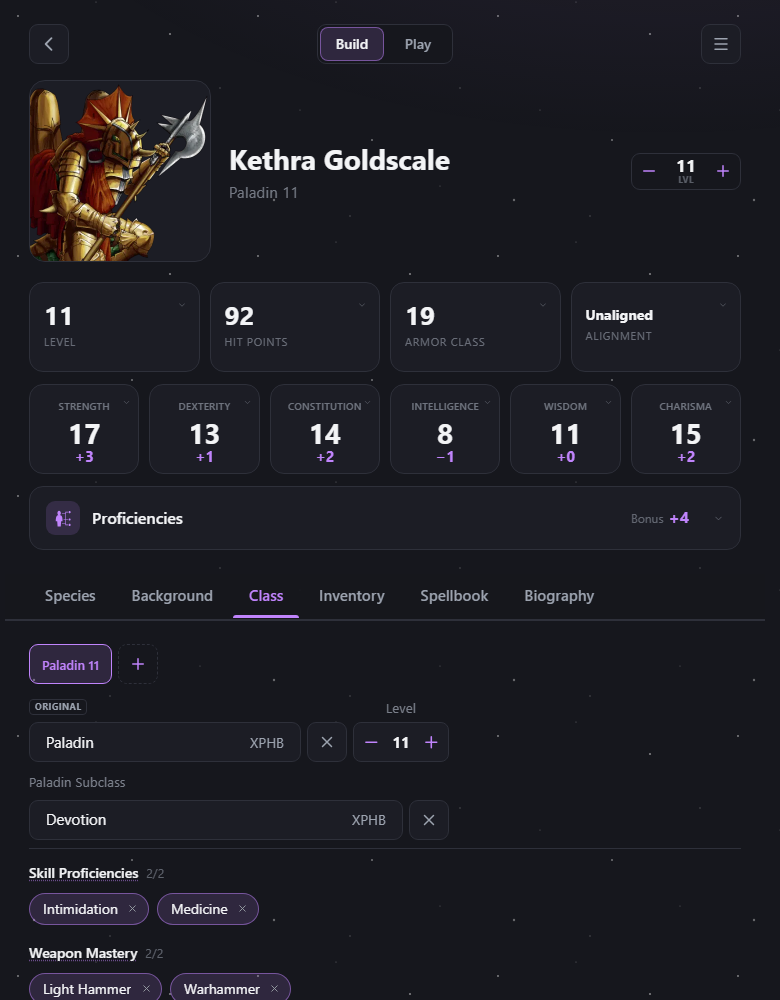
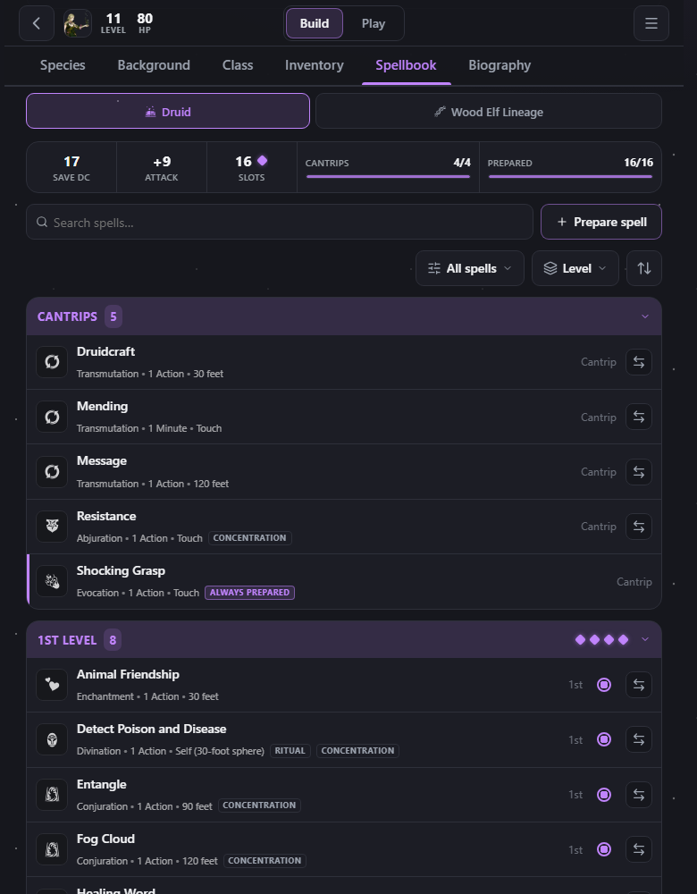
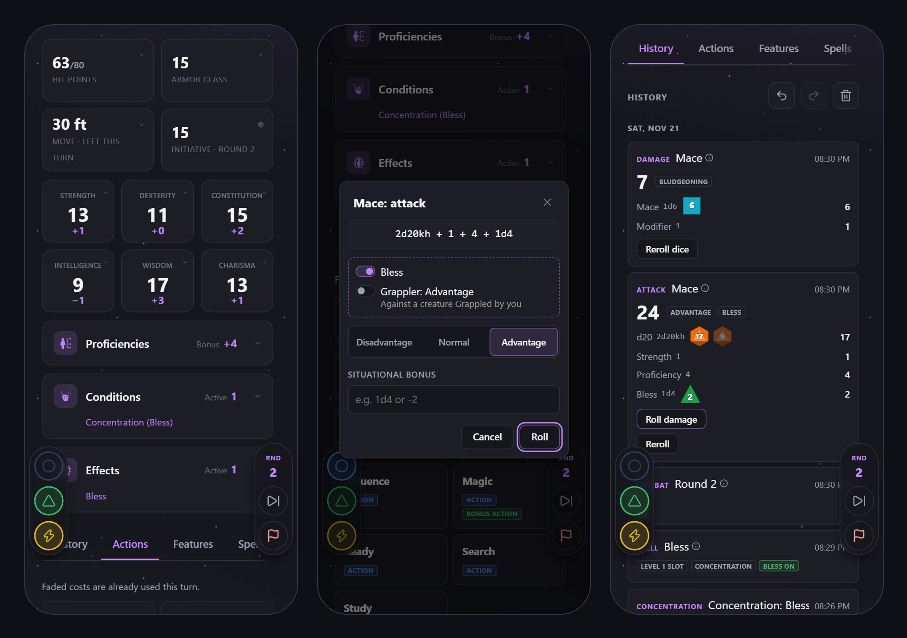
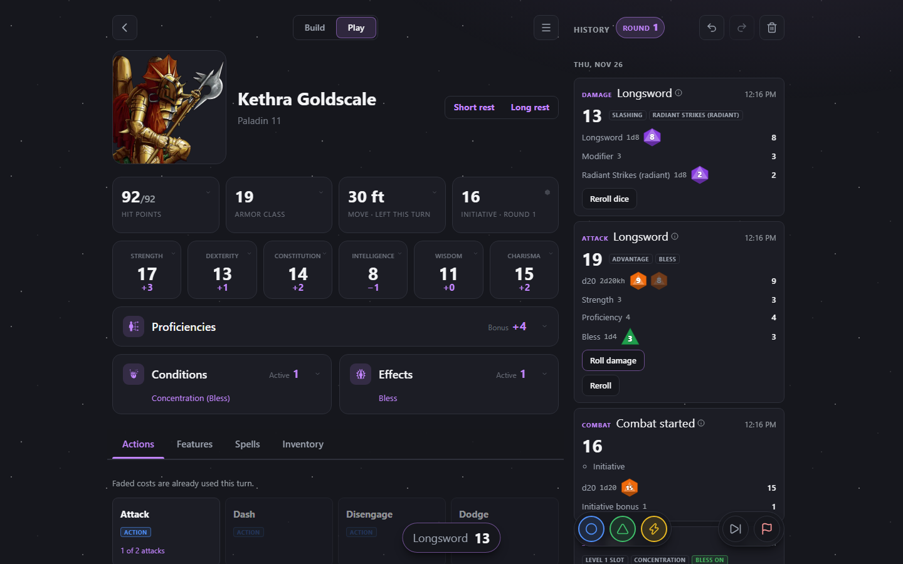
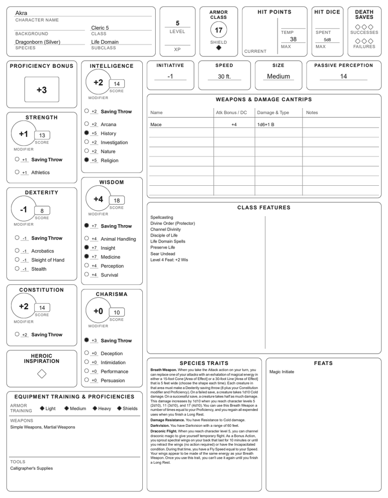
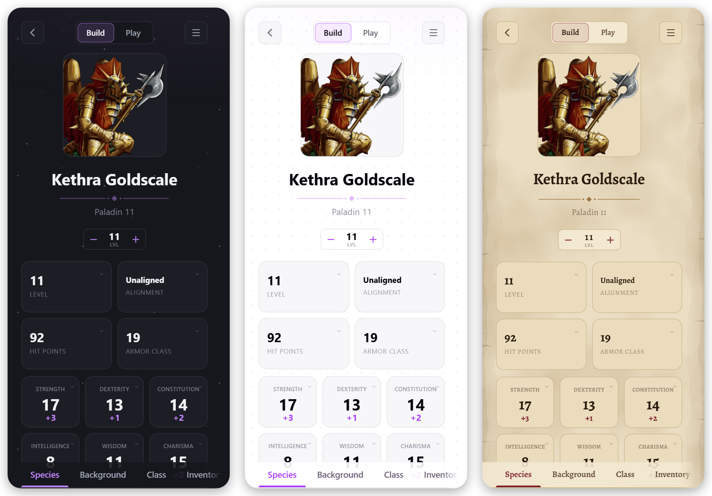

<p align="center">
  
</p>

<h1 align="center">FlyBy</h1>

<p align="center">
  <b>Create, manage and play your D&amp;D characters, with PDF and Foundry VTT export.</b><br>
  Free, open source, and all your data and characters stored locally.
</p>

<p align="center">
  <a href="https://flyby-hub.web.app"><b>Open FlyBy</b></a>
</p>

<p align="center">
  
</p>

## What is FlyBy?

FlyBy is a character app for **Dungeons &amp; Dragons, 5th edition, 2024 rules**. It builds your character with you, keeps the sheet up to date, plays it at the table, and takes it to paper or to [Foundry VTT](https://foundryvtt.com/). It runs in your browser, on a phone or a computer, with no account and no server: your characters stay on your device.

## Features

### Creation guide

Tap **New Character**, choose **Guide me**, and FlyBy asks one question at a time: class, species, background, ability scores, gear and every choice they bring. Each option shows its full description before you pick it, and nothing is final. The same guide helps you when you level up.

<p align="center"></p>

### Character builder

Every number on the sheet (hit points, armor class, saving throws, skills, spell slots) is worked out from your choices and recalculated the moment you change one. Species, background (built piece by piece, or a ready-made one from the 2024 books), class and multiclass, feats, spells and inventory each have their own tab, and every rule, spell or item mentioned anywhere opens its full text with a tap.

<table>
  <tr>
    <td width="50%"></td>
    <td width="50%"></td>
  </tr>
</table>

### Play mode

Switch a character from **Build** to **Play** and the sheet becomes the one you play with: roll every check, save, attack, damage and spell with a tap; take damage and heal; spend spell slots, hit dice and class resources; use your features and items; track conditions, concentration and effects such as Bless, which are added to the right rolls on their own; and take a short or long rest that gives back exactly what each feature says. Summons and Wild Shape forms get their own stat blocks, and a light combat mode counts rounds and your action, bonus action and reaction. Every roll and change goes into a history you can undo.

<p align="center"></p>

<p align="center"></p>

### PDF export

Export a filled-in, printable sheet made for FlyBy, on white or parchment: a combat page with the portrait, boxes to tick for hit points, death saves, spell slots and limited-use abilities, then your features, spells, equipment and story. Keep it to a few pages or print everything in full.

<p align="center"></p>

### Foundry VTT export and import

Export a character as a file that Foundry VTT (with its D&amp;D 5e system) opens with everything set up: class features, proficiencies, inventory, spells, and buttons to roll attacks and checks. You can also import a Foundry character back into FlyBy.

### Three themes

**Dark**, **Light** or **Parchment**, in **☰ > Settings**. By default FlyBy follows your device's light or dark mode.

<p align="center"></p>

### Content beyond the SRD

FlyBy comes with the **System Reference Document 5.2** (SRD), the free rules content published by Wizards of the Coast under an open license: all 12 classes (each with one subclass), 9 species, 4 backgrounds, 17 feats, over 300 spells and over 500 items. From the older **SRD 5.1** it adds, marked as legacy, only what the 2024 SRD left out (the Half-Elf and Half-Orc, 13 Eldritch Invocations, some classic gear).

Everything else (other books' subclasses, species, feats, spells and items) FlyBy reads from a **game data source you provide**, in the JSON format of the open-source [5e.tools](https://5e.tools) project. Open a **setup link** if someone in your group gave you one, or go to **☰ > Game data > Game data source** and paste the address of the data. FlyBy checks it, downloads the content once and keeps a copy on your device; **Copy setup link** in the same menu shares that source with your group. You can switch back to the built-in SRD at any time, and your characters are not affected.

<details>
<summary>Which addresses work, and which files FlyBy reads</summary>

FlyBy accepts:

- **A GitHub repository**, `https://github.com/<owner>/<repository>`, or a link to one of its folders or files. When the game data is in a folder named `data` at the root, FlyBy downloads only the files that changed when it checks for updates.
- **A GitHub release**, `https://github.com/<owner>/<repository>/releases/tag/<version>` (or `/releases/latest`). The data then stays at that version.
- **The address of a folder of game data** on any web server that serves it over `https` and allows other sites to read it (an `Access-Control-Allow-Origin` header).
- **A setup link** someone shared with you.

A source does not need every file: anything missing is left out (the **Game data source** menu says how many are missing), but a source with none of them is treated as a wrong address. The files, relative to the data folder:

| Where | Files |
|---|---|
| the folder itself | `races.json`, `fluff-races.json`, `backgrounds.json`, `fluff-backgrounds.json`, `feats.json`, `optionalfeatures.json`, `skills.json`, `languages.json`, `senses.json`, `items.json`, `items-base.json`, `fluff-items.json`, `magicvariants.json`, `variantrules.json`, `conditionsdiseases.json`, `actions.json`, `foundry-feats.json`, `foundry-races.json`, `foundry-optionalfeatures.json`, `foundry-items.json` |
| `class/` | `class-<name>.json` and `fluff-class-<name>.json` for each of the 13 classes (artificer, barbarian, bard, cleric, druid, fighter, monk, paladin, ranger, rogue, sorcerer, warlock, wizard), plus `foundry.json` |
| `spells/` | `spells-<source>.json` for each spell source FlyBy knows, the matching `fluff-spells-<source>.json` where they exist, `sources.json` and `foundry.json` |
| `bestiary/` | `index.json` and the files it lists (plus `objects.json` in the folder itself), read only when a summon, a form or a creature link needs them |
| `generated/` | `gendata-variantrules.json`, `gendata-tables.json` |

</details>

## Getting started

Open **[flyby-hub.web.app](https://flyby-hub.web.app)**. The first time, choose **Explore with SRD 5.2** (built in, ready right away) or **Use my own game data**. Then tap **New Character**. Your characters are saved on this device as you go.

To install it like an app (its own icon and window, and it works offline): on **iPhone and iPad**, Safari's **Share > Add to Home Screen**; on **Android**, Chrome's **⋮ > Install app**; on a **computer**, the install icon at the end of Chrome's or Edge's address bar. Updates arrive on their own.

> [!IMPORTANT]
> **Keep a backup of the characters you care about.** They live in your browser, and clearing its website data deletes them; use **Export** on a character, and **Import character** to bring it back or move it to another device. **On an iPhone or iPad, install FlyBy on the Home Screen:** Safari deletes the data of a website you have not opened in about a week, and the installed app keeps it. The installed app has its own storage, so export the characters you made in Safari and import them there.

## Questions

**Is it free? Do I need an account?**
Yes, it is free and open source, and there is no sign-up or login.

**Which rules does it use?**
The 2024 revision of the 5th edition rules.

**Does the play mode work with Foundry VTT?**
They are separate. What happens in the play mode (hit points, spent slots, conditions) stays in FlyBy and is not part of the Foundry export. Potions, arrows and coins you spend in play do come off the character, so the next export reflects them.

## Known limitations

- **Leveling up inside Foundry VTT.** A character exported from FlyBy brings the features of its current level. Foundry levels it up from the D&amp;D 5e system's compendiums, which only contain the SRD content, so anything from your own game data source cannot be added there without additional modules. **Level up in FlyBy, then export and import the character into Foundry again** (right-click it, then **Import Data**; this also replaces what changed during play there).
- **The play mode tracks your character, not the whole table.** Combat counts your own rounds, not everyone's turn order, and an effect you put on someone else (Bless on an ally) is theirs to track. Equipping gear and preparing spells stay in **Build**.

## For developers

FlyBy is a React and Vite single-page app with no backend. The rules engine is plain JavaScript with extensive unit tests.

```bash
npm install
npm run dev     # start the app locally
npm run test    # run the tests
npm run build   # production build
```

Game content uses the data format of the open-source [5e.tools](https://5e.tools) project. The SRD 5.2 bundle in `src/data/srdBundle.json` is generated from that data by `npm run gen:srd-bundle`, which also checks every name in it against the official SRD text. Any other content is read at runtime from a data source the user configures, and cached in the browser.

## Credits and license

The code is MIT licensed ([LICENSE](LICENSE)). Third-party material and its licenses are listed in [NOTICE](NOTICE) and, inside the app, under **☰ > About FlyBy**: the icons come from [game-icons.net](https://game-icons.net) (CC BY 3.0, credited by author) and [Lucide](https://lucide.dev) (ISC), and the Parchment theme and the PDF sheet use the Cinzel and Alegreya fonts (SIL Open Font License).

This work includes material from the System Reference Document 5.2 ("SRD 5.2") by Wizards of the Coast LLC, available at https://www.dndbeyond.com/srd. The SRD 5.2 is licensed under the Creative Commons Attribution 4.0 International License, available at https://creativecommons.org/licenses/by/4.0/legalcode.

This work includes material taken from the System Reference Document 5.1 ("SRD 5.1") by Wizards of the Coast LLC and available at https://dnd.wizards.com/resources/systems-reference-document. The SRD 5.1 is licensed under the Creative Commons Attribution 4.0 International License available at https://creativecommons.org/licenses/by/4.0/legalcode.

FlyBy is an unofficial fan-made tool. It is not affiliated with, endorsed, sponsored or approved by Wizards of the Coast, 5e.tools or Foundry Gaming LLC. Thanks to the 5e.tools community for the data format that makes this app possible.

<sub>The screenshots show the built-in SRD 5.2 content, in the Dark theme unless noted: the official SRD premade characters imported from their Foundry VTT files, and in the play mode one of the app's SRD test characters.</sub>
