<p align="center">
  
</p>

<h1 align="center">FlyBy</h1>

<p align="center">
  <b>Create and manage your D&amp;D characters, with PDF and Foundry VTT export.</b><br>
  Free, open source, and all your data and characters stored locally.
</p>

<p align="center">
  <a href="https://flyby-hub.web.app"><b>Open FlyBy</b></a>
</p>

<p align="center">
  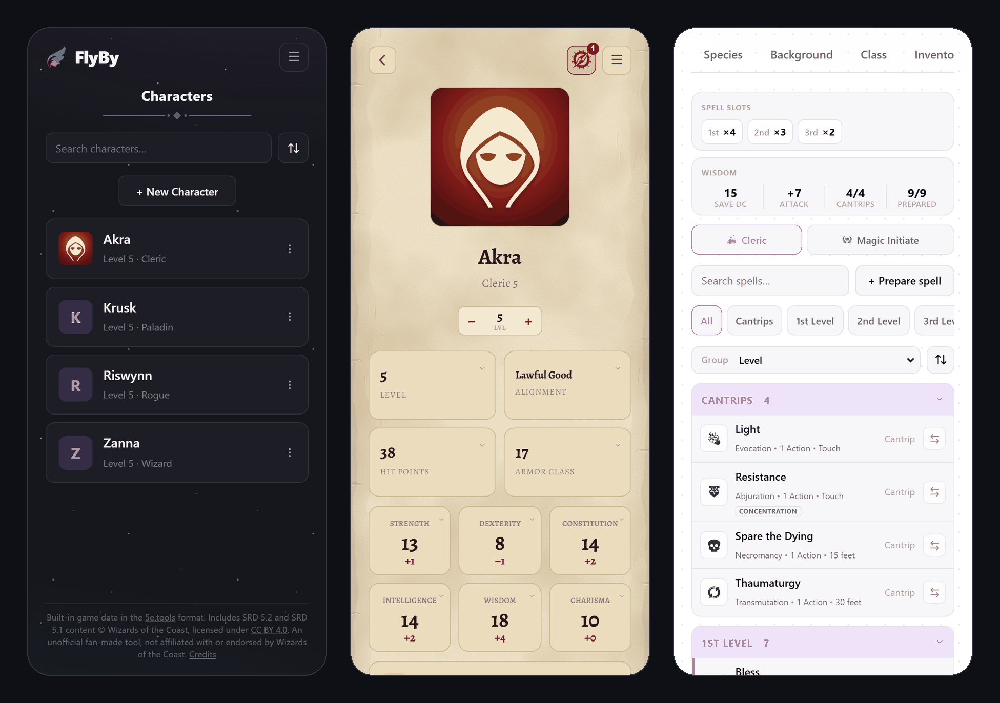
</p>

## What is FlyBy?

FlyBy is a character builder for **Dungeons &amp; Dragons, 5th edition, 2024 rules**. It helps you make a character step by step, and then keeps the character sheet up to date for you: change a choice and every number that depends on it (hit points, armor class, skills, spell slots) is recalculated on the spot.

- **New to D&amp;D?** A guide walks you through every decision, explains each option before you pick it, and nothing is final: you can change anything later.
- **Already playing?** Print a filled-in PDF sheet, or send your character straight into [Foundry VTT](https://foundryvtt.com/), the online tabletop many groups play on.

## What it can do

### A guide that builds the character with you

Tap **New Character**, choose **Guide me**, and FlyBy asks one question at a time: class, species, background, ability scores, gear, and the choices each of them brings. Every option opens a full description before you commit, so you always know what you are picking.

<table>
  <tr>
    <td width="50%">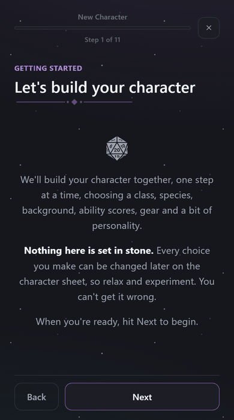</td>
    <td width="50%">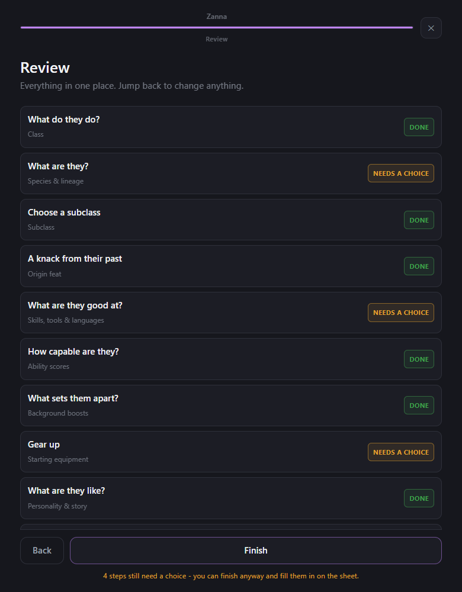</td>
  </tr>
  <tr>
    <td><b>One step at a time</b>: read about each class or species, then tap <i>Select</i>.</td>
    <td><b>Always know where you are</b>: a review screen shows what is done and what is left.</td>
  </tr>
</table>

### Every option explained before you choose

Every list in the app (classes, spells, feats, items) has a search bar, filters and a full preview. Filters that fit your character come already turned on, and you can switch them off whenever you want.

<p align="center">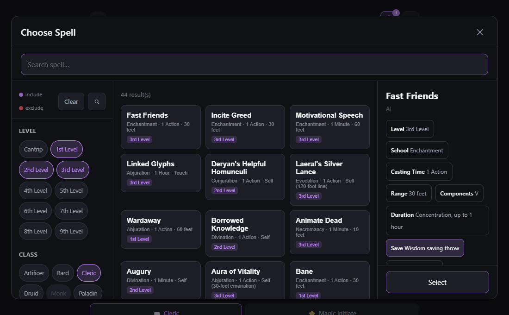</p>

### A sheet that does the math

Your ability scores, hit points, armor class, saving throws, skills and proficiencies are worked out from your choices. Level up with the <b>+</b> button and the app points out what the new level lets you choose.

<table>
  <tr>
    <td width="50%">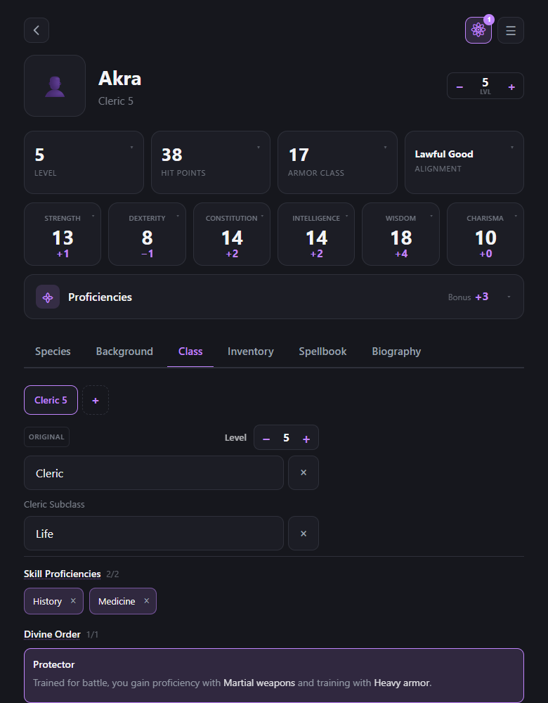</td>
    <td width="50%">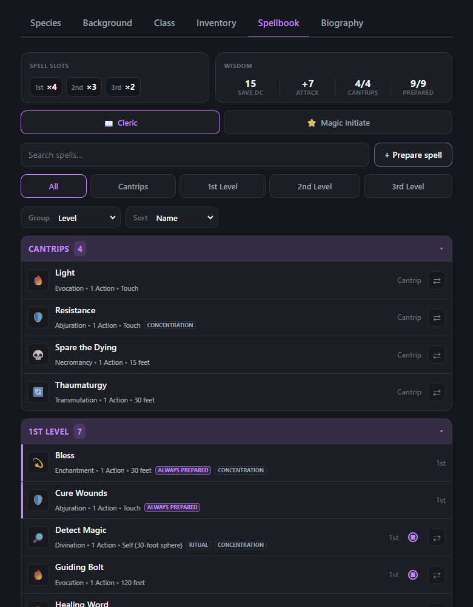</td>
  </tr>
  <tr>
    <td><b>Character sheet</b>: every number updates the moment you change something.</td>
    <td><b>Spellbook</b>: spell slots, save DC and how many spells you can prepare, kept for you.</td>
  </tr>
</table>

### Gear, money and a shop

Equip armor and weapons, track coins and how much you are carrying, and buy new equipment from a searchable shop that knows each item's price and weight.

<table>
  <tr>
    <td width="50%">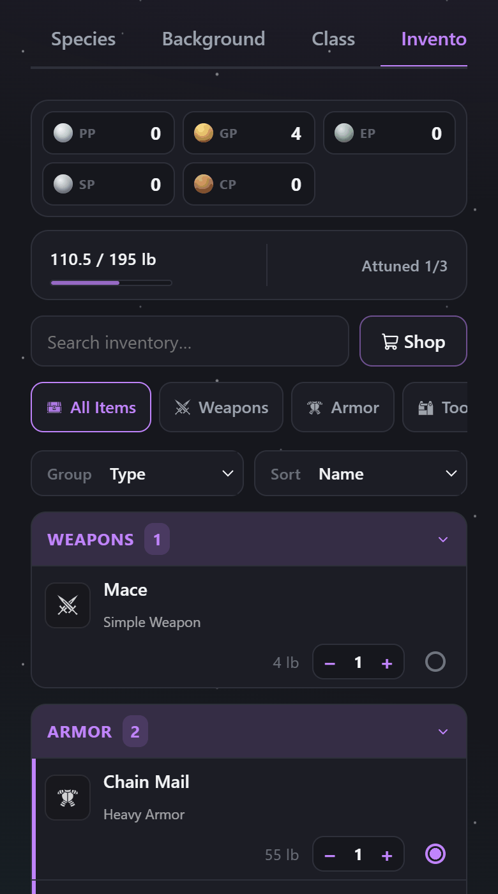</td>
    <td width="50%">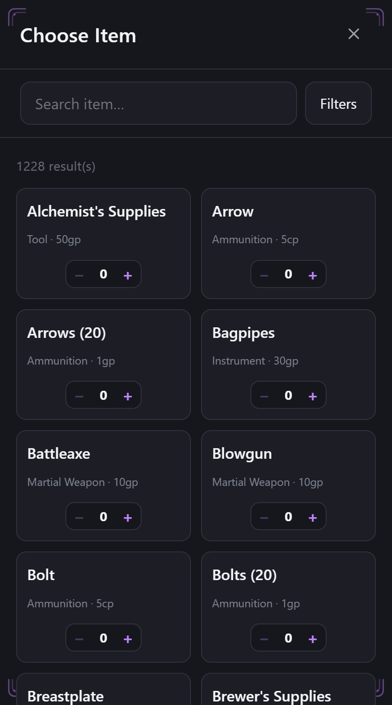</td>
  </tr>
  <tr>
    <td><b>Inventory</b>: coins, carried weight, attuned magic items and what you have equipped.</td>
    <td><b>Shop</b>: search, filter and add items with a tap.</td>
  </tr>
</table>

### Tap any rule to read it

Spells, conditions, actions and rules mentioned anywhere in the app are links. Tap one and its full description opens right there, so you never have to go looking through a book in the middle of a game. There is also a searchable glossary of every rule in the menu.

<table>
  <tr>
    <td width="50%">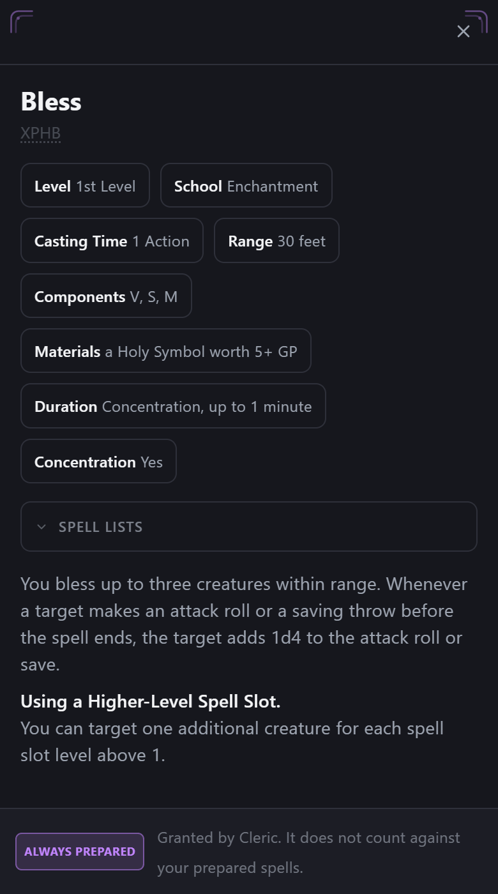</td>
    <td width="50%">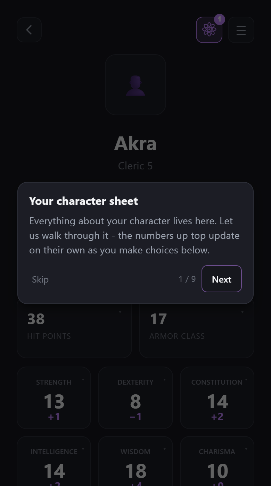</td>
  </tr>
  <tr>
    <td><b>Rules at your fingertips</b>: the full text of a spell, one tap away.</td>
    <td><b>Learn the app as you go</b>: short tutorials point out each part of the screen the first time you see it.</td>
  </tr>
</table>

### Take your character to the table

<table>
  <tr>
    <td width="50%">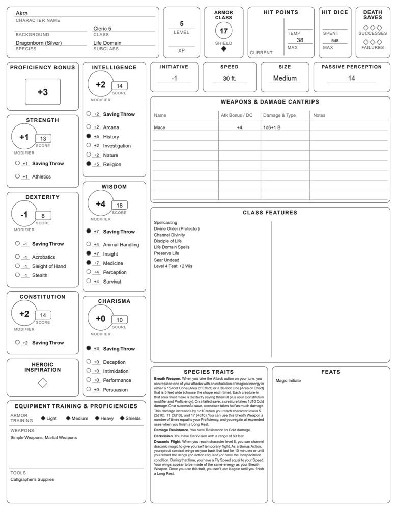</td>
    <td width="50%">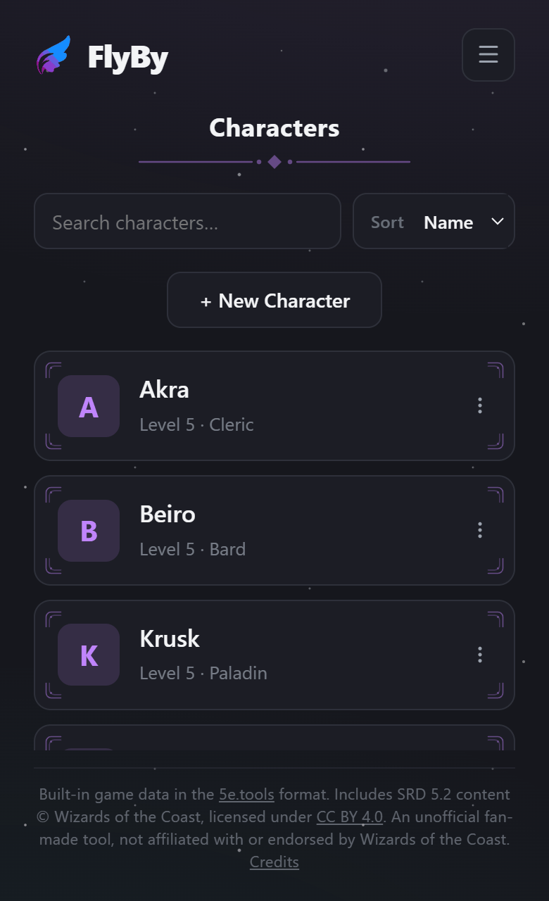</td>
  </tr>
  <tr>
    <td><b>Printable PDF</b>: a complete, filled-in sheet, ready to print. Multiclass characters get one sheet per class.</td>
    <td><b>All your characters in one place</b>: create, duplicate, export or delete them from the list.</td>
  </tr>
</table>

**Foundry VTT, both ways.** Export a character as a file that Foundry VTT (with its D&amp;D 5e system) opens with everything set up: class features, proficiencies, inventory, spells, and buttons to roll attacks and checks. You can also import a Foundry character back into FlyBy.

## Getting started

FlyBy runs in your web browser, on a phone or a computer: open **[flyby-hub.web.app](https://flyby-hub.web.app)**. You can use it right there, or install it like an app (step 4).

> [!IMPORTANT]
> **Using an iPhone or iPad?** Safari deletes the saved data of a website you have not opened in about a week, and in FlyBy that data includes your characters. **The fix is to install FlyBy on your Home Screen** (step 4): the installed app keeps its data. One catch: the installed app has its own storage, separate from Safari, so characters you made in Safari do not appear there by themselves. Export them in Safari first (**Export** on the character), then use **Import character** in the installed app. If you use a setup link, paste it on the installed app's welcome screen.
>
> The same cleanup applies to Safari on a Mac; there, use FlyBy from Chrome or Edge, or keep backups. And in any browser, clearing the history or website data deletes your characters, so keep a backup of the ones you care about.

**1. Choose where the game content comes from.** The first time you open FlyBy, it asks:

<p align="center">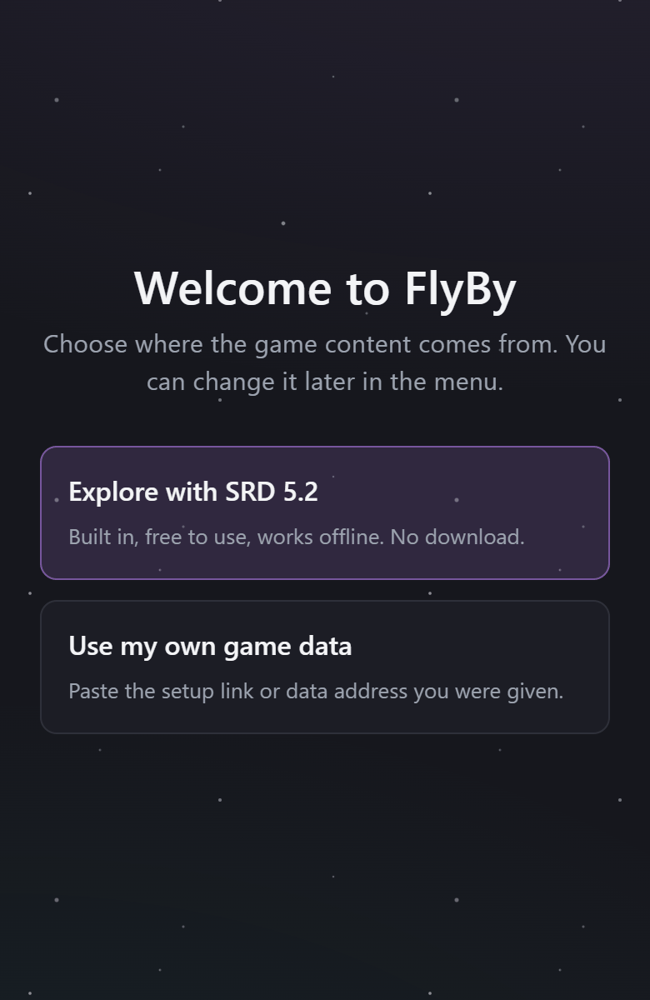</p>

- **Explore with SRD 5.2** - the official free rules content (see below), built into the app and ready right away.
- **Use my own game data** - if someone in your group gave you a **setup link**, just open it: FlyBy asks once to confirm, and from then on everything is ready. If you use FlyBy from your phone's home screen, you can also paste the setup link here.

You can change this at any time in the menu (**☰ > Game data source**).

**2. Make a character.** Tap **New Character** and choose **Guide me** for the step-by-step guide, or **Just the sheet** if you already know what you want.

**3. That's it.** Your character is saved automatically on this device. Come back any time and it is there.

**4. Install it (optional, recommended on iPhone and iPad).** FlyBy then gets its own icon and opens in its own window, without the browser bar.

- **iPhone and iPad (Safari):** tap the **Share** button, then **Add to Home Screen**.
- **Android (Chrome):** open the **⋮** menu and tap **Install app** (or **Add to Home screen**).
- **Computer (Chrome or Edge):** click the install icon at the right end of the address bar.

Updates arrive on their own: the next time you open the app after an update, you are on the new version.

> [!NOTE]
> **Using FlyBy without an internet connection.** After your first visit, FlyBy keeps itself on your device, so it can open without a connection, in the browser or installed. What works offline depends on what you do:
>
> - **Works offline:** opening the app, your characters, creating and editing characters with the built-in SRD 5.2 content, the rules glossary, and exporting to PDF or to Foundry VTT (both files are made on your device).
> - **Works offline after the first download:** content from your own game data source. FlyBy downloads it once, keeps a copy, and checks for updates about once a month; while offline it simply keeps using the copy it has.
> - **Needs a connection:** the very first visit, setting up or switching a game data source, picture art that comes with your own data source, and receiving app updates.

## Questions

**Is it free?**
Yes. FlyBy is free and open source.

**Do I need an account?**
No. There is no sign-up and no login: open it and start.

**Where are my characters saved? Can I move them to another device?**
In your browser, on that device only. Nobody else can see them. To move a character, or to keep a backup, use **Export** on the character (a small file) and **Import character** in the menu on the other device. Clearing your browser's site data deletes your characters, so keep a backup of the ones you care about. On iPhones and iPads, install the app to keep Safari from clearing it (see the note in Getting started).

**What content comes with the app?**
The **System Reference Document 5.2** (SRD), the free rules content published by Wizards of the Coast under an open license: all 12 classes (each with one subclass), 9 species, 4 backgrounds, 17 feats, over 300 spells and over 500 items, plus magic weapons and armor. Content from other books is not included; FlyBy can read it only from a game data source that you provide.

**How do I use my own game data?**
Open a **setup link** if someone gave you one, or go to **☰ > Game data source**, paste the address of a game data folder (or the whole setup link) and tap **Use this address**. FlyBy downloads the content once and keeps a copy on your device. You can switch back to the built-in SRD 5.2 at any time from the same menu; your characters are not affected.

**What address does FlyBy accept?**
The `https://` address of a folder of game data, the folder that holds the files listed below. The address must start with `https://`; a final `/` is optional. A few examples of what works:

- A folder in a GitHub repository, through its raw address: `https://raw.githubusercontent.com/<owner>/<repository>/<branch>/data/`. This is the best option: when the files are in a folder named `data` at the root of the repository, FlyBy downloads only the files that changed when it checks for updates.
- Any other web server or file host, as long as it serves the files over `https` and allows web pages from other sites to read them (the server sends an `Access-Control-Allow-Origin` header). On these, FlyBy downloads every file again when it updates, about once a month.

**What format does the game data need to be in?**
The JSON data format of the open-source 5e.tools project: the same folder layout, file names and fields. A copy of that project's `data` folder, or a mirror of it, works as it is. A source does not need every file: anything missing is simply left out (the **Game data source** menu tells you how many files a source is missing), but a source with none of them is treated as a wrong address.

<details>
<summary>The files FlyBy reads (74, all relative to the data folder)</summary>

| Where | Files |
|---|---|
| the folder itself | `races.json`, `fluff-races.json`, `backgrounds.json`, `feats.json`, `optionalfeatures.json`, `skills.json`, `languages.json`, `senses.json`, `items.json`, `items-base.json`, `fluff-items.json`, `magicvariants.json`, `variantrules.json`, `conditionsdiseases.json`, `actions.json`, `foundry-feats.json`, `foundry-races.json`, `foundry-optionalfeatures.json` |
| `class/` | `class-<name>.json` and `fluff-class-<name>.json` for each of the 13 classes (artificer, barbarian, bard, cleric, druid, fighter, monk, paladin, ranger, rogue, sorcerer, warlock, wizard), plus `foundry.json` |
| `spells/` | `spells-<source>.json` for each spell source FlyBy knows (17), the matching `fluff-spells-<source>.json` where they exist (9), and `sources.json` |
| `generated/` | `gendata-variantrules.json`, `gendata-tables.json` |

</details>

**How do I share my game data with my group?**
In **☰ > Game data source**, tap **Copy setup link** and send it to them. Opening it the first time sets up the same game data on their device, after a confirmation; opening it again later changes nothing. The link only carries the address of the data: nobody receives your characters.

**Who can see the game data address I use?**
Only you, on your device. FlyBy has no server: the address is saved in your browser, and the game data goes straight from that address to your device.

**Which rules does it use?**
The 2024 revision of the 5th edition rules.

**What is coming next?**
A **play mode**: a screen made for the table, to roll checks and attacks with a tap and keep track of hit points, spell slots and other resources during a session.

## Known limitations

- **Leveling up inside Foundry VTT.** A character exported from FlyBy brings the features of its current level. When you level it up inside Foundry, Foundry adds the new features from the D&amp;D 5e system's compendiums, which only contain the SRD content. Anything else (subclasses, species and options from your own game data source) is not there, so Foundry cannot add it. **Level up in FlyBy, then export and import the character into Foundry again.** In Foundry you can import the new file over the existing character (right-click it, then **Import Data**); note that this also replaces what changed during play there, such as current hit points and used spell slots.
- **Long lists on the PDF.** On high-level characters, very long lists of features or equipment may not fit in their boxes on the printed sheet.
- **No session tracking yet.** FlyBy keeps your character's build, not what happens at the table (current hit points, used spell slots, conditions). That is what the upcoming play mode is for.

## For developers

FlyBy is a React and Vite single-page app with no backend. The rules engine is plain JavaScript with extensive unit tests.

```bash
npm install
npm run dev     # start the app locally
npm run test    # run the tests
npm run build   # production build
```

Game content uses the data format of the open-source [5e.tools](https://5e.tools) project. The SRD 5.2 bundle in `src/data/srdBundle.json` is generated from that data by `npm run gen:srd-bundle`, which also checks every name in it against the official SRD text. Any other content is read at runtime from a data source the user configures, and cached in the browser.

## Credits and license

The code is MIT licensed ([LICENSE](LICENSE)). Third-party material and its licenses are listed in [NOTICE](NOTICE).

This work includes material from the System Reference Document 5.2 ("SRD 5.2") by Wizards of the Coast LLC, available at https://www.dndbeyond.com/srd. The SRD 5.2 is licensed under the Creative Commons Attribution 4.0 International License, available at https://creativecommons.org/licenses/by/4.0/legalcode.

FlyBy is an unofficial fan-made tool. It is not affiliated with, endorsed, sponsored or approved by Wizards of the Coast, 5e.tools or Foundry Gaming LLC. Thanks to the 5e.tools community for the data format that makes this app possible.

<sub>The screenshots show the built-in SRD 5.2 content and the official SRD premade characters, imported from their Foundry VTT files.</sub>
